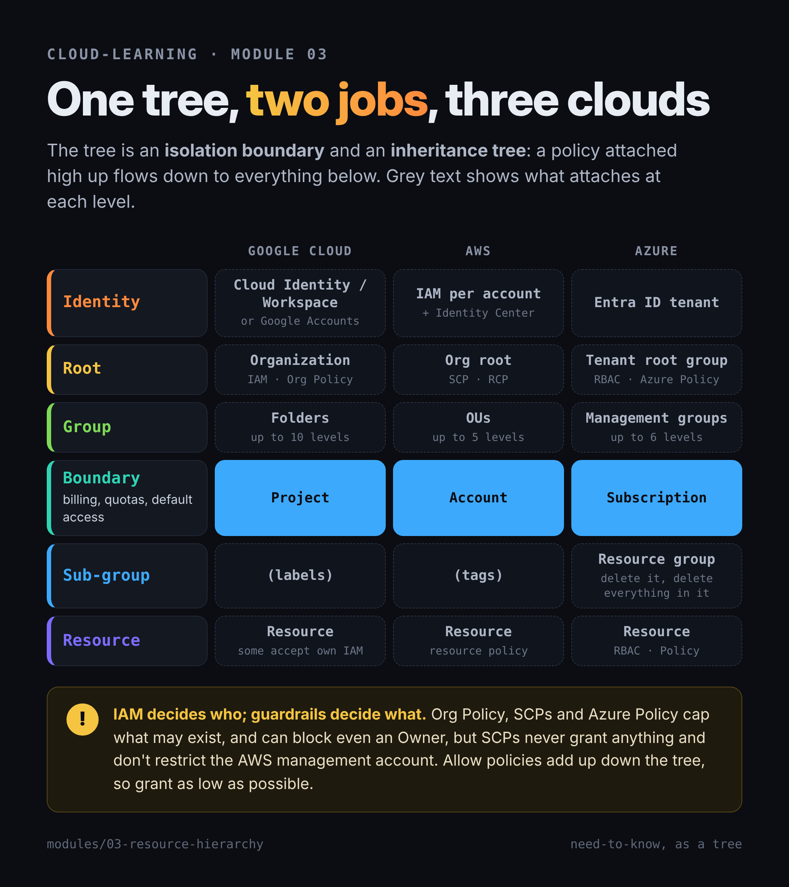

# 03 — Organizing resources: GCP org/folders/projects, AWS Organizations/accounts, Azure tenants/management groups/subscriptions

> **In one sentence:** you'll be able to draw each cloud's resource hierarchy from memory and explain it as two things at once — a **security boundary** and a **policy-inheritance tree**.

**Prereqs:** modules 00–02 · **Time:** ~3 hours incl. lab · **Phase:** 1

## Learning objectives

- Draw the hierarchy for Google Cloud, AWS, and Azure and name each level.
- Explain where access policies and guardrail policies attach, and how they inherit.
- Distinguish **who-can-do-what** controls (IAM) from **what-can-exist** controls (org policy, SCPs, Azure Policy).
- Choose the right isolation unit (project / account / subscription) for an environment or mission.
- Handle the personal-account reality: a Google Cloud **Organization** node needs Cloud Identity, Workspace, or (for new trial sign-ups) a standalone organization.

## Why this matters for the target roles

- **Customer engineer:** the first architecture conversation with any agency is "how do we lay out folders/accounts for programs, environments, and classification levels?" This *is* the landing zone (module 30).
- **Cloud security:** inheritance is how one policy protects thousands of projects — and how one bad grant at the top exposes all of them.
- **CTI:** attackers who gain high-level access modify the hierarchy itself to escape guardrails (ATT&CK T1666).

---

## Concepts

### The big idea: one tree, two jobs

Every cloud arranges resources in a tree. The tree does two jobs:

1. **Isolation boundary.** The lower containers (project, account, subscription) separate billing, quotas, and — by default — access. A breach in one doesn't automatically reach the next.
2. **Inheritance tree.** A policy attached high up flows down to everything below. Set it once at the top; it applies everywhere.

**Bridge to your intel background:** it's a classification and compartment structure. The org is the enterprise; folders/OUs are programs; projects/accounts are compartments. Access granted at the program level reaches every compartment in it. Need-to-know means granting as low in the tree as possible.

**Bridge to your homelab:** OPNsense rules on the parent interface group apply to every VLAN in the group; rules on one VLAN apply only there.

### Two kinds of policy

| Kind | Question it answers | Google Cloud | AWS | Azure |
|---|---|---|---|---|
| **Access (IAM)** | *Who* can do *what*? | IAM allow policies (and deny policies) | IAM policies (identity- and resource-based) | Azure RBAC role assignments |
| **Guardrail** | What is *allowed to exist* or be configured, no matter who asks? | **Organization Policy** constraints | **SCPs** and **RCPs** (AWS Organizations) | **Azure Policy** |

Google puts it neatly: IAM focuses on **who**; Organization Policy focuses on **what**. A guardrail can block even an Owner.

---

### Google Cloud: organization → folders → projects

```
Organization (example.com or yourname-org)
 ├─ Folder: Program-A
 │   ├─ Folder: Prod ── Project: a-prod-123 ── VMs, buckets…
 │   └─ Folder: Dev  ── Project: a-dev-456
 └─ Folder: Shared   ── Project: logging-789
```

- **Organization:** the root. Every resource except the org has exactly **one parent**.
- **Folders:** optional grouping, nested **up to 10 levels**, at most **300 folders** directly under one parent.
- **Projects:** the unit that holds resources, enables APIs, and links to billing. Each has a **project ID** (you choose; immutable; 6–30 characters), a **project number** (assigned), and a **display name** (changeable).
- **Inheritance:** IAM allow policies, deny policies, and org policies are inherited. A resource's effective allow policy is what's set on it **plus** everything inherited from ancestors. Because allow policies **add up**, you can't take away at a lower level what was granted higher up; **deny policies** are the tool for carving out exceptions.
- **Org policy override:** a descendant inherits its parent's org policy by default but can override it (if permitted). Dry-run mode logs would-be violations without blocking. Changes can take up to 15 minutes to enforce.
- **Who can set org policies:** the **Organization Policy Administrator** role, which Google's docs grant on the organization. A project Owner alone can't.

**What makes Google's model distinct:** projects are lightweight — creating one takes seconds — so teams use many of them. AWS accounts and Azure subscriptions are heavier.

#### The personal-account reality (read this before the lab)

The **organization** node doesn't always exist:

| Your situation | What you get |
|---|---|
| **New Free Trial customer** (signed up recently) | Possibly a **standalone organization**, created automatically when you accept the console terms. No domain needed; named like `yourname-org`; one per user account. You hold **Organization Owner** (`roles/cloudowner.admin`) and **Organization Administrator**. Google says this isn't available to existing accounts. |
| **Existing personal Google Account** | Projects sit under **"No organization."** No folders, no org-level IAM, no org policies you can set. |
| **Cloud Identity Free or Google Workspace** | A full organization tied to a **domain you own and verify**. Cloud Identity Free provides identity management without Workspace email. |

Org Admin alone doesn't let you create folders or projects; you grant yourself the **Folder Creator** and **Project Creator** roles if you need them (least privilege by design).

---

### AWS: Organizations → OUs → accounts

```
Organization (management account pays the bill)
 └─ Root  ── SCPs here apply to all member accounts
     ├─ OU: Security   ── Account: log-archive, Account: security-tooling
     ├─ OU: Workloads
     │   ├─ OU: Prod   ── Account: app-prod
     │   └─ OU: Dev    ── Account: app-dev
     └─ OU: Sandbox    ── Account: brian-lab
```

- **Account:** the hard isolation boundary in AWS — its own root user, IAM, resources, and (by default) bill. Module 00: AWS bundles identity + billing + resources into the account.
- **AWS Organizations:** groups accounts. **No additional charge** — but on the post-July-2025 AWS free plan, joining an organization **automatically upgrades the account to the paid plan** (module 00's trial-cliff box). One **management account** (pays for everything; can't be changed), one **root**, zero or more **OUs** (nested up to **5 levels** under the root), and member accounts. Default quota: **10 accounts** (adjustable).
- **Policy types:** authorization policies — **SCPs** (cap what principals in member accounts can do) and **RCPs** (cap what can be done to resources) — plus a growing set of declarative and management policies (tag, backup, AI-services opt-out, EC2 declarative, and more).
- **SCPs are guardrails, not grants.** They set the **maximum** permissions available; IAM policies in the account still have to grant access. Up to 10 SCPs attached directly per root, OU, or account.
- **Critical gotcha:** **SCPs don't restrict the management account.** That's why AWS tells you to keep workloads out of it.

### Azure: tenant → management groups → subscriptions → resource groups → resources

```
Microsoft Entra ID tenant (identities live here)
 └─ Tenant root group (root management group, ID = tenant ID)
     ├─ MG: Platform   ── Subscription: connectivity, Subscription: identity
     └─ MG: Workloads
         ├─ MG: Prod   ── Subscription: app-prod ── RG: app-web ── VMs, storage…
         └─ MG: Dev    ── Subscription: app-dev  ── RG: app-test
```

- **Entra ID tenant:** the identity directory. Every subscription **trusts exactly one tenant**; a tenant can be trusted by many subscriptions.
- **Management groups:** up to **six levels** of depth (not counting the root and the subscription level), up to **10,000** per directory, one parent each. The built-in **tenant root group** can't be moved or deleted; working at that level requires a Global Administrator to elevate access.
- **Subscription:** the billing and quota boundary — closest to a GCP project or AWS account.
- **Resource group:** a container for resources that share a lifecycle. Each resource is in exactly one; **deleting a resource group deletes everything in it** (handy for lab cleanup; dangerous in production).
- **Inheritance:** Azure RBAC and Azure Policy both inherit down four scopes: management group → subscription → resource group → resource.
- **Gotcha:** moving a subscription to a different tenant **drops its RBAC role assignments**; they don't transfer.

---

## Text diagram — the three side by side, with policy attach points

```
              GOOGLE CLOUD           AWS                       AZURE
Identity  →   Cloud Identity /       IAM per account +         Entra ID tenant
              Workspace / Google     Identity Center
              Accounts
Root      →   Organization [IAM,OP]  Org root [SCP,RCP]        Tenant root MG [RBAC,Policy]
Group     →   Folder(s)    [IAM,OP]  OU(s)    [SCP,RCP]        Mgmt group(s)  [RBAC,Policy]
Boundary  →   Project      [IAM,OP]  Account  [SCP,RCP,IAM]    Subscription   [RBAC,Policy]
Sub-group →   (labels/tags)          (tags)                    Resource group [RBAC,Policy]
Resource  →   Resource     [IAM*]    Resource [resource pol.]  Resource       [RBAC,Policy]

IAM = access policy · OP = Organization Policy · * some resources accept their own IAM
```



## Google Cloud vs AWS vs Azure

| Capability | Google Cloud | AWS | Azure | Notable difference |
|---|---|---|---|---|
| Root node | Organization (needs Cloud Identity/Workspace, or standalone org for new trial sign-ups) | Organization root (management account) | Tenant root management group | Google's org is tied to an identity domain; AWS's to a payer account |
| Grouping | Folders (10 levels) | OUs (5 levels) | Management groups (6 levels) | Depth limits differ |
| Isolation/billing unit | Project (lightweight) | Account (heavyweight) | Subscription (+ resource groups inside) | GCP projects are cheap to create and delete |
| Access policy | IAM allow + deny, inherited | IAM in each account; Identity Center across accounts | RBAC, inherited | AWS IAM doesn't inherit across accounts — accounts are hard walls |
| Guardrails | Organization Policy | SCPs / RCPs / other org policies | Azure Policy | SCPs skip the management account |
| Guardrail can block an Owner/admin? | Yes | Yes (in member accounts) | Yes (deny effects) | |
| Cost of the hierarchy itself | You pay for resources, not folders/projects ⚠️ unverified (no explicit pricing statement found) | Organizations: **no additional charge** (documented) | You pay for resources, not MGs/resource groups ⚠️ unverified (no explicit pricing statement found) | Only AWS states it outright |

## Administer and monitor it

- **See the tree:** Google — console **Manage resources**, `gcloud projects get-ancestors`; AWS — Organizations console, `aws organizations list-roots` / `list-organizational-units-for-parent`; Azure — **Management groups** blade, `az account management-group list`.
- **See effective access:** `gcloud projects get-ancestors-iam-policy`; AWS IAM Access Analyzer / policy simulator (module 14); Azure **Access control (IAM) → Check access**.
- **Log changes to the tree:** hierarchy changes are control-plane events in Cloud Audit Logs, CloudTrail (in the management account), and the Azure Activity Log (module 18). Alert on folder/OU/MG moves and policy detachments.

## Security angle

- **Grant low, guard high.** Grant IAM roles at the lowest level that works; attach guardrails at the highest level that makes sense.
- **Top-level grants are force multipliers.** An Owner role at the org or a Global Admin who elevates to the tenant root reaches *everything*.
- **The management account (AWS) and org admins (GCP) are crown jewels.** No workloads there; minimal humans; phishing-resistant MFA (module 00).
- **Separate environments by container, not by naming convention.** `prod` and `dev` in one project/account/subscription share a blast radius.
- **Shared responsibility:** the provider supplies the hierarchy and policy engines. **Designing the tree, granting the roles, and writing the guardrails are entirely the customer's** — the same identity-and-access line from module 01.

## Threat intel angle

- **T1666 Modify Cloud Resource Hierarchy** — adversaries move accounts or projects (or create new ones) to escape guardrails, or leave the organization entirely. Watch for `LeaveOrganization`, OU moves, project/folder moves, and new subscriptions.
- **T1078.004 Valid Accounts: Cloud Accounts** — high-level credentials are worth more because of inheritance; one org-level grant opens many projects.
- **Persistence via policy:** an attacker with enough access may add a quiet IAM binding at the folder/MG level instead of on individual resources, where reviewers look less often.
- **Detection idea:** treat any change to SCPs, org policies, or Azure Policy assignments as high-severity, and require change tickets for them.

## Public sector notes

- **Hierarchy maps to authorization boundaries.** Agencies commonly align folders/OUs/management groups with systems that hold separate ATOs, and with impact levels. Assured Workloads (module 02) applies its control packages at the **folder** level for exactly this reason.
- **Multi-agency and program separation** is usually done with separate accounts/subscriptions/projects, and sometimes separate organizations or tenants.
- AWS GovCloud accounts and Azure Government tenants sit in their own environments, so commercial and government hierarchies are separate trees (module 27).

## Key takeaways

- The hierarchy is both a **security boundary** and a **policy-inheritance tree**.
- IAM answers **who**; guardrails (Org Policy / SCPs / Azure Policy) answer **what may exist** — and can block admins.
- Google: org → folders (10 deep) → projects; inheritance is additive, so carve-outs need deny policies.
- AWS: org root → OUs (5 deep) → accounts; SCPs cap but don't grant, and don't touch the management account.
- Azure: tenant → management groups (6 deep) → subscriptions → resource groups; RBAC and Policy inherit; moving a subscription between tenants drops role assignments.
- A personal Google Account may have **no Organization node**; folders and org policies need one.
- Designing the tree and its policies is **always the customer's** job.

## Sources

- [Google Cloud — About resource hierarchy](https://docs.cloud.google.com/resource-manager/docs/overview)
- [Google Cloud — Creating and managing organization resources](https://docs.cloud.google.com/resource-manager/docs/creating-managing-organization)
- [Google Cloud — Set up standalone organizations](https://docs.cloud.google.com/resource-manager/docs/standalone-organization-overview)
- [Google Cloud — Resource Manager quotas and limits](https://docs.cloud.google.com/resource-manager/docs/limits)
- [Google Cloud — Organization Policy overview](https://docs.cloud.google.com/organization-policy/overview)
- [Google Cloud — Create organization policies](https://docs.cloud.google.com/organization-policy/create-organization-policies)
- [Google Cloud — Set up Cloud Identity as a Google Cloud admin](https://docs.cloud.google.com/identity/docs/how-to/set-up-cloud-identity-admin)
- [AWS Organizations — Terminology and concepts](https://docs.aws.amazon.com/organizations/latest/userguide/orgs_getting-started_concepts.html)
- [AWS Organizations — Quotas](https://docs.aws.amazon.com/organizations/latest/userguide/orgs_reference_limits.html)
- [AWS Organizations — Billing and pricing](https://docs.aws.amazon.com/organizations/latest/userguide/pricing.html)
- [AWS Billing — Choosing an AWS Free Tier plan (Organizations auto-upgrade)](https://docs.aws.amazon.com/awsaccountbilling/latest/aboutv2/free-tier-plans.html)
- [AWS CLI — Organizations examples](https://docs.aws.amazon.com/cli/latest/userguide/cli_organizations_code_examples.html)
- [Microsoft — What are Azure management groups?](https://learn.microsoft.com/en-us/azure/governance/management-groups/overview)
- [Microsoft — Azure RBAC scope](https://learn.microsoft.com/en-us/azure/role-based-access-control/scope-overview)
- [Microsoft — Azure Resource Manager overview](https://learn.microsoft.com/en-us/azure/azure-resource-manager/management/overview)
- [Microsoft — Associate or add an Azure subscription to your Microsoft Entra tenant](https://learn.microsoft.com/en-us/entra/fundamentals/how-subscriptions-associated-directory)
- [MITRE ATT&CK — T1666 Modify Cloud Resource Hierarchy](https://attack.mitre.org/techniques/T1666/)

Verified: 2026-10-23
