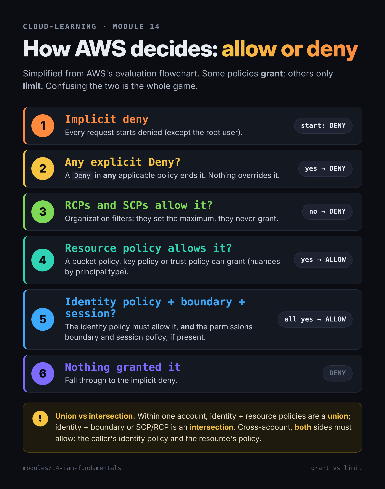

# 14 — IAM fundamentals: principals, roles, policies, and least privilege across all three clouds

> **In one sentence:** you'll be able to explain precisely how Google Cloud, AWS, and Azure decide whether a request is allowed — allow and deny policies, policy types and evaluation order, RBAC scopes versus directory roles — and how to find and remove excess permissions, especially on service accounts with long-lived keys.

**Prereqs:** modules 00–13 (module 03 for the hierarchy and guardrails; modules 05–07 for workload identities; module 11 for VPC Service Controls) · **Time:** ~4 hours incl. lab · **Phase:** 4

## Learning objectives

- Define **principal**, **permission**, **role**, **policy**, and **scope**, and map them across the three clouds.
- Explain Google's **allow policies**, **deny policies**, and **principal access boundary** policies, and how they're inherited and evaluated.
- Walk through AWS **policy evaluation logic**: identity vs resource policies, permissions boundaries, SCPs/RCPs, session policies, explicit deny.
- Distinguish **Azure RBAC** (resources, by scope) from **Microsoft Entra roles** (the directory).
- Explain why **service-account keys** are dangerous and what replaces them.
- Use each cloud's tools to find **excess permissions**.

## Why this matters for the target roles

- **Customer engineer / architect:** IAM design is the first security question in every landing zone. Explaining Google's hierarchy-based model next to AWS's and Azure's — accurately — is a credibility test.
- **Cloud security:** Google's Cloud Threat Horizons reports attributed **47.1%** of observed initial access in H1 2025 to weak or absent credentials; the H1 2026 edition (covering H2 2025) found identity issues underpinned **83%** of the cloud and SaaS incidents it examined, even as software exploitation overtook weak credentials as the top entry vector. IAM is where cloud breaches start and spread.
- **CTI:** cloud intrusions are identity intrusions. Reading an attacker's path means reading permissions.

---

## Concepts

### The vocabulary, once

- **Authentication (authN)** — proving who you are. (Module 15 goes deep.)
- **Authorization (authZ)** — deciding what you may do. This module.
- **Principal** — the "who": a person, group, or workload identity.
- **Permission** — one action on one kind of resource (e.g., `storage.objects.get`, `s3:GetObject`, `Microsoft.Storage/storageAccounts/read`).
- **Role** — a named bundle of permissions.
- **Policy** — the document that connects principals, roles/permissions, and resources.
- **Scope** — where a policy applies; on all three clouds, policies set high in the hierarchy flow down (module 03).
- **Least privilege** — only the permissions needed, only where needed, only for as long as needed.

**Bridge to your intel background:** this is need-to-know and compartments. A **role** is a read-on list for a program; a **binding at a scope** is reading someone into a specific compartment; **inheritance** is being read into a program and therefore every compartment under it. The classic mistake is the same one you've seen with over-broad billets: granting at the program level because it's easier, when need-to-know was one compartment.

### Google Cloud: allow policies on the hierarchy

**An allow policy** is attached to a resource (organization, folder, project, or many individual resources such as a bucket). It holds **bindings**: *role* → *list of principals*, optionally with a **condition**.

```yaml
bindings:
- role: roles/storage.objectViewer
  members:
  - group:analysts@agency.example
  - serviceAccount:etl@prod-123.iam.gserviceaccount.com
- role: roles/storage.objectAdmin
  members: [user:alex@agency.example]
  condition:
    title: expires-end-of-month
    expression: request.time < timestamp('2026-11-30T00:00:00Z')
```

**Principals** are written with prefixes: `user:`, `serviceAccount:`, `group:`, `domain:`, the special `allUsers` (anyone on the internet) and `allAuthenticatedUsers` (any Google account), and `principal://` / `principalSet://` identifiers for federated identities (module 15).

**Role types:**

- **Basic roles** — Owner, Editor, Viewer (Google now calls these *legacy basic roles*; new Admin/Writer/Reader basic roles are in Preview). They span thousands of permissions across every service. Google's guidance: **don't grant basic roles in production** unless there's no alternative. You can't add conditions to the legacy ones.
- **Predefined roles** — service-specific, maintained by Google (e.g., `roles/storage.objectViewer`, `roles/compute.networkAdmin`).
- **Custom roles** — your own permission lists, created at the **organization or project** level (not folders). Up to 300 per org and 300 per project.

**Inheritance is additive.** A project's effective access is its own policy **plus** everything granted on its folders and organization. You can't remove at a lower level what was granted above (module 03).

**IAM Conditions** use a subset of the CEL expression language — time limits (`request.time`), resource names or types, and resource tags. Not allowed with `allUsers`/`allAuthenticatedUsers`.

Limits worth knowing: up to **1,500 principals** per allow policy; groups count as one, which is one reason to **grant to groups, not individuals**.

### Google Cloud: deny policies and principal access boundaries

- **Deny policies** attach to an organization, folder, or project and are inherited downward. They name principals and permissions that are **denied regardless of any allow**, with optional **exception principals** and conditions (tag-based). Only a subset of permissions can be denied; the permission format is different (`SERVICE_FQDN/RESOURCE.ACTION`, e.g., `iam.googleapis.com/roles.create`). Managing them takes `roles/iam.denyAdmin`, which Google's docs describe granting at the organization.
- **Principal access boundary (PAB) policies** (GA December 2024) attach to a *set of principals* — e.g., everyone in a workforce pool — and define which resources those principals are **eligible** to access at all. They never grant; they only bound.

**Evaluation order on Google Cloud:** **PAB → deny → allow.** If a PAB policy excludes the resource, access is denied. Else if a deny policy matches, denied. Else if an allow policy grants the permission, allowed. Otherwise, denied by default. (Organization Policy, from module 03, is a separate guardrail on *configuration*, not part of this access check.)

### AWS: policy types and evaluation logic

AWS has more policy types, and the distinction between **grant** and **limit** is the whole game.

| Policy type | Attached to | Grants? |
|---|---|---|
| **Identity-based** (AWS managed, customer managed, inline) | User, group, role | Yes |
| **Resource-based** (e.g., S3 bucket policy, KMS key policy, role trust policy) | A resource; names a `Principal` | Yes |
| **Permissions boundary** | A user or role | No — sets the maximum |
| **SCP** (service control policy) | Org root, OU, account | No — maximum for principals in the account |
| **RCP** (resource control policy) | Org root, OU, account | No — maximum for resources in the account |
| **Session policy** | An assumed-role or federated session | No — limits that session |
| **ACLs** | Some resources (legacy) | Yes (cross-account) |

A policy is JSON: `Effect` (Allow/Deny), `Action`, `Resource`, optional `Condition`, and `Principal` in resource-based policies.

```json
{ "Version": "2012-10-17",
  "Statement": [{ "Effect": "Allow",
                  "Action": ["s3:GetObject"],
                  "Resource": "arn:aws:s3:::agency-reports/*" }] }
```

**Evaluation logic, simplified from AWS's flowchart:**

1. Everything starts **implicitly denied** (except the root user, module 00).
2. **Any explicit Deny** in any applicable policy → **denied**. Stop.
3. **RCPs** and **SCPs** must allow it (they're filters, not grants).
4. A **resource-based policy** Allow can grant access (with nuances by principal type).
5. Otherwise the **identity-based policy** must allow it — **and** the **permissions boundary** and **session policy**, if present, must allow it too.

Within one account: identity + resource policies are a **union**; identity + boundary (or SCP/RCP) is an **intersection**. **Cross-account**, *both* sides must allow: the caller's identity policy and the resource's policy.



**Roles and temporary credentials:** an IAM **role** has no password or long-term key. Its **trust policy** (a resource-based policy) says who may call `sts:AssumeRole`; STS returns short-lived credentials. AWS's best practice: federated humans and roles for workloads; IAM users with long-term **access keys** only when unavoidable.

### Azure: RBAC scopes versus Entra directory roles

Azure has **two separate permission systems**, and confusing them is the most common Azure IAM mistake.

| | **Azure RBAC (Azure roles)** | **Microsoft Entra roles** |
|---|---|---|
| Controls | Azure **resources** — VMs, storage, networks | The **directory** — users, groups, apps, tenant settings |
| Examples | Owner, Contributor, Reader, User Access Administrator, Role Based Access Control Administrator | Global Administrator, User Administrator, Application Administrator |
| Scope | Management group → subscription → resource group → resource (inherited) | Tenant (or administrative units) |
| Where you assign | "Access control (IAM)" on the scope | Entra admin center → Roles and administrators |

- **Role assignment** = principal + role definition + scope. Assignments are **additive**.
- **Owner** can assign roles; **Contributor** can manage everything but can't assign roles.
- **Deny assignments** exist but **you can't create them directly** — Azure creates them (e.g., deployment stacks' deny settings).
- **Conditions** on role assignments (attribute-based) refine some data-plane assignments, such as storage blobs by tag.
- Limit: **5,000 role assignments per subscription**.
- **The bridge between the systems:** a **Global Administrator** has no Azure resource access by default, but can flip **"elevate access"** to gain **User Access Administrator at root scope (`/`)** — every subscription in the tenant. Microsoft says to remove it after use; it's logged. Watch for it.

### Service accounts, workload identities, and the key problem

Workloads need identities too (module 05 introduced them):

| | Google Cloud | AWS | Azure |
|---|---|---|---|
| Workload identity | **Service account** (user-managed, default, or Google-managed service agents) | **IAM role** (instance profile, execution role) | **Managed identity** (system- or user-assigned) or service principal |
| Long-lived secret option | **Service-account key** (JSON) | **Access key** on an IAM user | **Client secret / certificate** on a service principal |
| Preferred | Attached SA, **impersonation**, Workload Identity Federation | Roles + STS | Managed identities (no credentials to handle) |

**Why keys are dangerous:** a JSON key or access key is a bearer credential that never expires by itself. It ends up in Git repos, CI variables, laptops, and container images (T1552.001). Anyone holding it *is* the service account, from anywhere — unless VPC Service Controls or similar stops them (module 11).

**Google's defaults have shifted:** organizations created on or after **May 3, 2024** get "secure by default" org policies, including **blocking service-account key creation and upload** and **no automatic Editor grant** to default service accounts. (Constraint names: `iam.disableServiceAccountKeyCreation` / `iam.managed.disableServiceAccountKeyCreation`, and the upload equivalents.)

**Impersonation instead of keys:** a person or workload with **`roles/iam.serviceAccountTokenCreator`** on a service account can mint short-lived tokens for it (`--impersonate-service-account`). The access is logged and revocable, and nothing sits on disk.

**Two privilege-escalation paths to know:**

- **`iam.serviceAccounts.actAs`** (in `roles/iam.serviceAccountUser`) lets you attach a service account to a VM, function, or job — and then run code with that SA's permissions. Granting it on a powerful SA is granting that SA's power. AWS's analog is **`iam:PassRole`** — permission to hand a role to a service (an EC2 instance, a Lambda function), which then acts with that role's permissions.
- **Token Creator** on a powerful SA is equivalent to holding its permissions. MITRE lists this pattern under **T1548.005 Temporary Elevated Cloud Access**.

### Finding excess permissions

| | Google Cloud | AWS | Azure |
|---|---|---|---|
| "Why was this allowed/denied?" | **Policy Troubleshooter** | **IAM policy simulator** | "Check access" on a scope |
| "Who has access to what?" | **Policy Analyzer** (free up to 20 queries/org/day) | **IAM Access Analyzer** external access (free) and internal access ($9/resource/region/month) | Role assignment lists; Entra access reviews (P2/Governance) |
| "Which permissions are unused?" | **Role recommendations** (90 days of usage; free for basic roles, SCC Premium/Enterprise for others) | **Last accessed information** (free); Access Analyzer **unused access** ($0.20/role or user/month) | Defender for Cloud **Permissions Management (CIEM)** in Defender CSPM |
| Unused identities/keys | **Activity Analyzer** and service-account insights (Preview) | Credential report; last used | Access reviews; sign-in activity |

Microsoft's standalone **Entra Permissions Management** was retired in late 2025; Defender CSPM's CIEM extension continues.

### Just-in-time access (preview of module 15)

The best standing permission is none. All three clouds offer time-bound elevation: Google **Privileged Access Manager**, Azure **Privileged Identity Management**, and on AWS, partner tools or the AWS-provided TEAM sample on IAM Identity Center. Module 15 covers them.

> **Shared responsibility — say it plainly:** the provider runs the IAM engine and evaluates policies correctly. **Every grant, role choice, scope, key, trust policy, and boundary is the customer's.** Identity and access control are always the customer's responsibility, in every service model.

---

## Text diagram — how a request is decided

```
 GOOGLE CLOUD                       AWS                                  AZURE
 request: principal P, perm X,      request: principal P, action X,      request: principal P, action X,
          resource R                         resource R                           scope R
   │                                  │                                    │
   ├─ PAB policy excludes R? → DENY   ├─ explicit Deny anywhere? → DENY    ├─ deny assignment matches? → DENY
   ├─ deny policy (org→folder→       ├─ RCP / SCP allow? no → DENY        ├─ any role assignment at R or
   │   project) matches? → DENY       ├─ resource policy Allow? → ALLOW*   │   above includes X (and its
   ├─ allow policy on R or any       ├─ identity policy Allow           │   condition is true)? → ALLOW
   │   ancestor grants X (and         │   AND boundary AND session         └─ else → DENY
   │   condition true)? → ALLOW       │   policy allow? → ALLOW
   └─ else → DENY                     └─ else → DENY                     (Entra directory roles: separate system)
                                      * cross-account: both sides must allow
```

## Google Cloud vs AWS vs Azure

| Capability | Google Cloud | AWS | Azure | Notable difference |
|---|---|---|---|---|
| Where policy attaches | Resources in the hierarchy (allow policy per resource) | Identities (identity policies) **and** resources (resource policies) | Scopes (role assignments) | AWS splits grants across two places |
| Role bundles | Basic / predefined / custom roles | AWS managed / customer managed policies | Built-in / custom role definitions | |
| Explicit deny | **Deny policies** (org/folder/project) | `"Effect": "Deny"` in any policy | Deny assignments (Azure-created only) | Only AWS lets you write denies inline everywhere |
| Maximum-permission guardrails | **Principal access boundary**; (Org Policy for config) | **Permissions boundaries, SCPs, RCPs, session policies** | (Azure Policy for config; no user-defined permission ceiling ⚠️) | AWS has the richest set |
| Conditions | IAM Conditions (CEL: time, resource, tags) | `Condition` keys (source IP, org ID, MFA, tags…) | Role-assignment conditions (ABAC, some data actions) | |
| Directory admin vs resource admin | Cloud Identity/Workspace admin roles vs IAM | IAM (no separate directory) / Identity Center | **Entra roles vs Azure RBAC** | Azure's split is the trap |
| Workload identity | Service account | IAM role | Managed identity | |
| Long-lived secret to avoid | SA key (blocked by default in new orgs) | IAM user access key | Service principal secret | |
| Excess-permission tooling | Role recommendations, Policy Analyzer, Troubleshooter | Access Analyzer, last accessed, simulator | Defender CSPM CIEM, access reviews | |

## Administer and monitor it

- **Grant to groups**, managed in the identity provider (module 15), not to individuals.
- **Review effective access** before and after changes: `gcloud projects get-ancestors-iam-policy`, Policy Troubleshooter; `aws iam simulate-principal-policy`; `az role assignment list --all`.
- **Logs:** every IAM change is an Admin Activity / CloudTrail / Activity Log event — `SetIamPolicy`, `CreateServiceAccountKey`, `AttachRolePolicy`, `CreateAccessKey`, `roleAssignments/write`, and Entra audit events for elevate access (module 18). These are among the highest-value alerts in the cloud.
- **Hygiene cadence:** quarterly role recommendations / last-accessed reviews; key inventory; break-glass account checks (module 00).

## Security angle

1. **Basic/broad roles in production** — Owner/Editor everywhere, `AdministratorAccess` on workloads, Owner at subscription scope.
2. **Granting high in the tree** (org/folder/management group) when one project or resource group was needed.
3. **Service-account keys and access keys** in code, CI, and laptops; never rotated; never inventoried.
4. **`allUsers` / `allAuthenticatedUsers`** on resources (module 08's public-bucket problem is an IAM problem).
5. **actAs / Token Creator / PassRole** granted casually — escalation paths in disguise.
6. **Azure Global Administrator elevate access** left on.
7. **Over-permissive trust policies** — an AWS role trusting `*` or a federated issuer without tight conditions (module 15).

## Threat intel angle

- **T1078.004 Valid Accounts: Cloud Accounts** — the front door. Weak/absent credentials were 47.1% of initial access in Google's H1 2025 data and 27.2% in H2 2025, when third-party software exploitation (44.5%) took the top spot — but identity still underpinned 83% of incidents in the H1 2026 report.
- **T1552.001 Credentials In Files** and **T1552.005 Cloud Instance Metadata API** — harvested keys and metadata tokens (module 05).
- **T1087.004 Account Discovery: Cloud Account**, **T1069.003 Permission Groups Discovery: Cloud Groups**, **T1580 Cloud Infrastructure Discovery** — enumeration after access; noisy `List`/`Get`/`testIamPermissions` bursts.
- **T1098.001 Additional Cloud Credentials** and **T1098.003 Additional Cloud Roles** — persistence: a new SA key or access key, a new Owner binding.
- **T1548.005 Temporary Elevated Cloud Access** — abusing impersonation, PassRole, or JIT mechanisms.
- **Public case:** Google's Cloud Threat Horizons H1 2026 report describes **UNC6426**: a trojanized npm package stole a developer's GitHub personal access token; the actor then abused the organization's GitHub-to-AWS OIDC trust to get temporary credentials for an over-permissive CloudFormation deployment role, and deployed a stack that **created a new role with AdministratorAccess** — token to admin in under 72 hours. Google's recommendations include federated identities that impersonate a minimal downstream service account, no `iam.serviceAccounts.create`/`iam.roles.create` for deployment identities, and JIT for risky IAM actions.

**Detection ideas:** new SA keys or access keys; new bindings of Owner/Editor/admin roles; `actAs`/`getAccessToken` by unusual principals; Entra elevate access events; enumeration bursts from a new IP or token.

**Bridge to your CTI work:** an attacker's path through IAM is a link chart — identities as nodes, `can-impersonate` and `can-attach` as edges. Graph-based tools (and Google's lateral-movement insights) do this; analysts who think in link analysis read it naturally.

## Public sector notes

- **NIST SP 800-53 AC-6 (Least Privilege)** and **AC-2 (Account Management)** are the controls assessors map this module to (module 26).
- **Separation of duties** (AC-5) maps to splitting network, security, and app admin roles — Shared VPC's model from module 10.
- **Domain restricted sharing** (`iam.managed.allowedPolicyMembers`) keeps agency resources from being granted to outside identities — a common agency requirement and part of Google's secure-by-default baseline.

## Key takeaways

- Principal + role + scope = a grant. Grant to groups, at the lowest scope, with the narrowest role, for the shortest time.
- Google: allow policies on resources, inherited and additive; deny policies and PABs restrict; evaluation PAB → deny → allow.
- AWS: identity and resource policies grant; boundaries, SCPs, RCPs, and session policies only limit; explicit deny always wins; cross-account needs both sides.
- Azure: RBAC for resources at four scopes; Entra roles for the directory; elevate access links them.
- Replace long-lived keys with attached identities, impersonation, and federation.
- Use recommendations, analyzers, and last-accessed data to shrink access. **IAM is always the customer's responsibility.**

## Sources

- [Google Cloud — Principals](https://docs.cloud.google.com/iam/docs/principals-overview), [Roles and permissions](https://docs.cloud.google.com/iam/docs/roles-overview), [IAM quotas and limits](https://docs.cloud.google.com/iam/quotas), [IAM Conditions](https://docs.cloud.google.com/iam/docs/conditions-overview)
- [Google Cloud — Deny policies](https://docs.cloud.google.com/iam/docs/deny-overview) and [Deny access](https://docs.cloud.google.com/iam/docs/deny-access)
- [Google Cloud — Principal access boundary policies](https://docs.cloud.google.com/iam/docs/principal-access-boundary-policies) and [Policy types and evaluation](https://docs.cloud.google.com/iam/docs/policy-types)
- [Google Cloud — Service account types](https://docs.cloud.google.com/iam/docs/service-account-types), [Service account permissions](https://docs.cloud.google.com/iam/docs/service-account-permissions), [Use service account impersonation](https://docs.cloud.google.com/docs/authentication/use-service-account-impersonation), [Restrict service accounts](https://docs.cloud.google.com/organization-policy/restrict-service-accounts), [Baseline constraints](https://docs.cloud.google.com/resource-manager/docs/manage-baseline-constraints), [Domain restricted sharing](https://docs.cloud.google.com/organization-policy/domain-restricted-sharing)
- [Google Cloud — Role recommendations](https://docs.cloud.google.com/policy-intelligence/docs/role-recommendations-overview), [Policy Intelligence billing](https://docs.cloud.google.com/policy-intelligence/docs/billing-questions), [Troubleshoot access](https://docs.cloud.google.com/policy-intelligence/docs/troubleshoot-access), [Policy Analyzer](https://docs.cloud.google.com/policy-intelligence/docs/policy-analyzer-overview), [Service account usage tools](https://docs.cloud.google.com/policy-intelligence/docs/service-account-usage-tools)
- [Google Cloud — Cloud Threat Horizons H2 2025](https://cloud.google.com/security/report/resources/cloud-threat-horizons-report-h2-2025) and [H1 2026](https://cloud.google.com/security/report/resources/cloud-threat-horizons-report-h1-2026)
- [AWS — Policies and permissions](https://docs.aws.amazon.com/IAM/latest/UserGuide/access_policies.html), [Policy elements](https://docs.aws.amazon.com/IAM/latest/UserGuide/reference_policies_elements.html), [Policy evaluation logic](https://docs.aws.amazon.com/IAM/latest/UserGuide/reference_policies_evaluation-logic.html), [Deny vs allow flow](https://docs.aws.amazon.com/IAM/latest/UserGuide/reference_policies_evaluation-logic_policy-eval-denyallow.html), [Cross-account evaluation](https://docs.aws.amazon.com/IAM/latest/UserGuide/reference_policies_evaluation-logic-cross-account.html)
- [AWS — IAM roles](https://docs.aws.amazon.com/IAM/latest/UserGuide/id_roles.html), [IAM best practices](https://docs.aws.amazon.com/IAM/latest/UserGuide/best-practices.html), [Access Analyzer pricing](https://aws.amazon.com/iam/access-analyzer/pricing/), [Last accessed information](https://docs.aws.amazon.com/IAM/latest/UserGuide/access_policies_last-accessed-view-data.html), [simulate-principal-policy](https://docs.aws.amazon.com/cli/latest/reference/iam/simulate-principal-policy.html)
- [Microsoft — Azure RBAC overview](https://learn.microsoft.com/en-us/azure/role-based-access-control/overview), [Privileged built-in roles](https://learn.microsoft.com/en-us/azure/role-based-access-control/built-in-roles/privileged), [Deny assignments](https://learn.microsoft.com/en-us/azure/role-based-access-control/deny-assignments), [RBAC limits](https://learn.microsoft.com/en-us/azure/role-based-access-control/troubleshoot-limits), [Azure roles vs Entra roles](https://learn.microsoft.com/en-us/azure/role-based-access-control/rbac-and-directory-admin-roles), [Elevate access](https://learn.microsoft.com/en-us/azure/role-based-access-control/elevate-access-global-admin), [Assign roles with Azure CLI](https://learn.microsoft.com/en-us/azure/role-based-access-control/role-assignments-cli)
- [Microsoft — Managed identities](https://learn.microsoft.com/en-us/entra/identity/managed-identities-azure-resources/overview), [Permissions Management offboarding](https://learn.microsoft.com/en-us/entra/permissions-management/how-to-offboard-permissions-management), [Defender for Cloud Permissions Management (CIEM)](https://learn.microsoft.com/en-us/azure/defender-for-cloud/enable-permissions-management)
- [NIST SP 800-53 Rev. 5](https://csrc.nist.gov/pubs/sp/800/53/r5/upd1/final)
- [MITRE ATT&CK — T1078.004](https://attack.mitre.org/techniques/T1078/004/), [T1098.001](https://attack.mitre.org/techniques/T1098/001/), [T1098.003](https://attack.mitre.org/techniques/T1098/003/), [T1552.001](https://attack.mitre.org/techniques/T1552/001/), [T1552.005](https://attack.mitre.org/techniques/T1552/005/), [T1087.004](https://attack.mitre.org/techniques/T1087/004/), [T1069.003](https://attack.mitre.org/techniques/T1069/003/), [T1548.005](https://attack.mitre.org/techniques/T1548/005/), [T1580](https://attack.mitre.org/techniques/T1580/)

Verified: 2026-10-26
