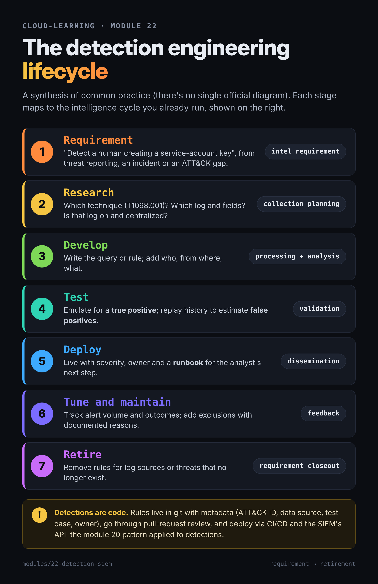

# 22 — Cloud detection engineering and SIEM: Google SecOps, Microsoft Sentinel, AWS options; MITRE ATT&CK cloud matrices

> **In one sentence:** you'll be able to take a threat, map it to the ATT&CK cloud matrices, find the log that shows it (module 18), and write, test, and deploy a detection for it — in YARA-L for Google Security Operations, KQL for Microsoft Sentinel, and AWS-native query languages — translating from the Splunk SPL you already know.

**Prereqs:** modules 00–21 (module 18 is essential — every detection here is built on those audit logs; module 19 for log-based alerts; module 21 for posture vs threat findings) · **Time:** ~4 hours incl. lab · **Phase:** 6

## Learning objectives

- Describe the **detection engineering lifecycle** and **detection as code**.
- Navigate the **ATT&CK cloud matrices** (IaaS, SaaS, Office Suite, Identity Provider) and the v18+ **Detection Strategies**.
- Compare **Google Security Operations**, **Microsoft Sentinel**, and **AWS's building blocks**, including pricing and trial realities.
- Read and write basic **YARA-L 2.0**, **KQL**, and **CloudWatch Logs Insights** detections against cloud audit logs.
- Translate between **SPL**, KQL, and YARA-L, and explain **Sigma** as a portable format.

## Why this matters for the target roles

- **Cloud CTI / detection:** turning threat reporting into working detections is the core skill. In cloud, the "endpoint" is the control-plane API, and the telemetry is the audit log.
- **Customer engineer:** Google SecOps is a flagship Google Public Sector offering; you'll be asked how it compares with Sentinel and Splunk, and how a customer migrates detections.
- **Cloud security:** detections are what make the logs from module 18 worth their cost.

---

## Concepts

### The detection engineering lifecycle

There's no single official diagram; this synthesis follows common practice and maps neatly to the intelligence cycle you already run:

| Stage | Detection engineering | Intel-cycle analog |
|---|---|---|
| 1. **Requirement** | "Detect a human creating a service-account key" — from threat reporting, an incident, or an ATT&CK coverage gap | Intelligence requirement |
| 2. **Research** | Which technique (T1098.001)? Which log, which fields? Is the log on and centralized (module 18)? | Collection planning |
| 3. **Develop** | Write the query/rule; add context (who, from where, what) | Processing and analysis |
| 4. **Test** | Emulate the behavior to get a **true positive**; run against historical data to estimate **false positives** | Validation |
| 5. **Deploy** | Rule goes live with severity, owner, and a **runbook** (what the analyst does next — module 23) | Dissemination |
| 6. **Tune and maintain** | Track alert volume and outcomes; add exclusions with documented reasons | Feedback |
| 7. **Retire** | Remove rules for log sources or threats that no longer exist | Requirement closeout |



**Detection as code:** rules live in git with metadata (ATT&CK ID, data source, test case, owner), go through pull-request review, and deploy via CI/CD and the SIEM's API — the module 20 pattern applied to detections. Google's SecOps community publishes this workflow (rules in git, deployed through the SecOps API); Sentinel can deploy content from source-control repositories ⚠️ (feature details not re-verified this run).

**Quality vocabulary:**

- **True/false positive, false negative** — fired correctly / fired wrongly / missed it.
- **Precision vs coverage** — a narrow rule (exact `methodName`) is quiet but easy to evade; a broad one catches variants but is noisy. MITRE's **Summiting the Pyramid** project scores how robust an analytic is to evasion.
- **Atomic vs behavioral** — one event ("trail stopped") vs a sequence or threshold ("20 denied calls in 10 minutes, then a successful one").

### ATT&CK for cloud, as of v20 (October 2026)

- The **Cloud matrix** covers four platforms: **IaaS**, **SaaS**, **Office Suite**, and **Identity Provider**. These names replaced "Azure AD," "Office 365," and "Google Workspace" in **v16** (October 2024).
- **v19 (April 2026)** split **Defense Evasion** into **Stealth** (TA0005) and **Defense Impairment** (TA0112), and revoked T1562 Impair Defenses in favor of **T1685 Disable or Modify Tools** — so cloud log tampering is **T1685.002** (module 18). Older reports and rule tags use T1562.008.
- **v18 (October 2025)** replaced the free-text "Detection" sections with **Detection Strategies** and **Analytics**: per-platform logic, required log sources, and tunable "mutable elements." Example: **DET0289** (detecting Disable or Modify Cloud Log) includes an IaaS analytic watching for CloudTrail `StopLogging`/`DeleteTrail` and Google `UpdateSink`. Start your research stage there.

Cloud techniques you'll detect most often:

| Technique | ID | Matrix platforms |
|---|---|---|
| Valid Accounts: Cloud Accounts | T1078.004 | IaaS, Identity Provider, Office Suite, SaaS |
| Account Manipulation: Additional Cloud Credentials | T1098.001 | IaaS, Identity Provider, SaaS |
| Account Manipulation: Additional Cloud Roles | T1098.003 | IaaS, Identity Provider, Office Suite, SaaS |
| Disable or Modify Cloud Log | T1685.002 | IaaS and others |
| Cloud Infrastructure Discovery | T1580 | IaaS |
| Data from Cloud Storage | T1530 | IaaS, Office Suite, SaaS |
| Transfer Data to Cloud Account | T1537 | IaaS, Office Suite, SaaS |
| MFA Request Generation | T1621 | Identity Provider and others |

### Google Security Operations (Google SecOps)

- Formerly **Chronicle**; now **Google Security Operations**, Google's security operations platform built around a SIEM, with SOAR and threat-intelligence capabilities depending on package ⚠️ (package contents not re-verified this run). Sold in **Standard, Enterprise, and Enterprise Plus** packages priced on ingestion, with **12 months of hot retention** included. **No self-serve free trial** — it's sales-led, which is why this module's lab doesn't use it hands-on.
- **UDM (Unified Data Model):** every log is parsed into common fields — `metadata.event_type`, `metadata.product_event_type`, `principal.user.email_addresses`, `principal.ip`, `target.*`, `security_result.action`. Write a rule once against UDM; it works for any source mapped there. Google Cloud Audit Logs arrive with the ingestion label **`GCP_CLOUDAUDIT`**, and the audit-log `methodName` lands in `metadata.product_event_type`.
- **Direct ingestion** of Google Cloud data (audit logs, Cloud DNS, firewall, NAT, SCC findings) is configured from the Google Cloud side.
- **YARA-L 2.0** is the rule language. Sections: `meta`, `events` (which events and how they join), `match` (group-by plus time window, e.g., `$user over 15m`), `outcome` (computed fields like counts and risk scores), `condition` (when to fire), `options`.
- **Curated detections** (Google-maintained rule sets, including a **Cloud Threats** category and Applied Threat Intelligence), **composite detections** (rules that take other detections as input), and **Gemini** assistance.
- **BigQuery export** of SecOps data at no storage charge for the retention period — module 09's analytics skills transfer.

**Splunk bridge:** Google publishes a "Transition from SPL to YARA-L 2.0" guide. Roughly: `index/sourcetype` → UDM fields + log type; `search` filters → `events` predicates; `stats … by user` → `match: $user over …` with `outcome` aggregates; `where count > 5` → `condition`. The big mental shift: YARA-L rules are **continuous** (they run over streaming data with a window) rather than scheduled searches.

### Microsoft Sentinel

- Cloud SIEM/SOAR on a **Log Analytics workspace**, queried with **KQL**. **After March 31, 2027, Sentinel is supported only in the Microsoft Defender portal**; new tenants have been onboarded there automatically since July 2025.
- **Pricing:** pay-as-you-go per GB or commitment tiers (from 100 GB/day), 90 days of retention included; **31-day free trial** with the first 10 GB/day of analytics-tier ingestion free. Some sources are always free: **AzureActivity**, Office 365 audit, Defender alerts. The **Sentinel data lake** tier stores data cheaply for up to 12 years.
- **Analytics rule types:** **Scheduled** (KQL on a timer), **NRT** (near-real-time, about every minute), **anomaly** (ML), threat intelligence matching. Fusion and the "Microsoft security" rule type aren't available once Sentinel is in the Defender portal — Defender XDR does that correlation, and Microsoft is steering new custom rules toward Defender **custom detections**.
- **Multicloud connectors:** Google Cloud audit logs via a Pub/Sub connector into the **`GCPAuditLogs`** table (authenticated with workload identity federation — module 15); AWS via an S3 + SQS connector into **`AWSCloudTrail`** (plus VPC Flow Logs, GuardDuty).
- **Splunk bridge:** Microsoft's migration guide maps `stats` → `summarize`, `eval` → `extend`, `table` → `project`, `rex` → `matches regex`, and SPL `where` → KQL `where`; its **SIEM migration experience** converts Splunk detections. KQL pipes left-to-right like SPL — most Splunk users are productive in a day.

### AWS: building blocks, not one SIEM

AWS doesn't sell a single SIEM; you assemble one or bring your own:

| Need | AWS service |
|---|---|
| Managed threat detection | **GuardDuty** (module 21) — reads CloudTrail, VPC Flow Logs, DNS on its own |
| Correlated findings | **AWS Security Hub** (new, Dec 2025) |
| Security data lake | **Amazon Security Lake** — S3, Parquet, normalized to **OCSF**; query with Athena or feed a third-party SIEM |
| Rule-based detection on logs | **OpenSearch Service Security Analytics** — ships prepackaged **Sigma** rules, CloudTrail detector |
| Ad hoc hunting | **CloudWatch Logs Insights** (on a trail delivered to CloudWatch Logs) |
| Real-time single-event alerts | **CloudWatch metric filters + alarms** (CIS-style), **EventBridge** rules on `AWS API Call via CloudTrail` |

Many AWS-heavy agencies run Splunk, Google SecOps, or Sentinel on top. That's normal, and it's a CE conversation.

### Sigma: write once, translate everywhere

**Sigma** is an open, vendor-neutral YAML rule format. Its taxonomy has cloud log sources (`product: aws` / `service: cloudtrail`; `product: azure` / `activitylogs`, `signinlogs`, `auditlogs`; `product: gcp` / `gcp.audit`), and **pySigma** backends convert rules to Splunk SPL, KQL, Elasticsearch, and others. A community backend for Google SecOps (UDM/YARA-L) exists ⚠️ (third-party; check its maintenance status). Sigma is how detection content survives a SIEM migration.

---

## Text diagram — one detection, three languages

```
 Threat report: "actor creates SA keys for persistence" ─► ATT&CK T1098.001 ─► DET strategy / log source
                                                                                │
   Google Cloud Audit Logs (Admin Activity: CreateServiceAccountKey) ◄──────────┘   (module 18)
        │ direct ingest              │ Pub/Sub connector              │ aggregated sink
        ▼                            ▼                                ▼
   Google SecOps (UDM)          Microsoft Sentinel (GCPAuditLogs)   Cloud Logging
   YARA-L rule, continuous      KQL scheduled / NRT rule            log-based alert (lab)
        │                            │                                │
        └───────────── alert ──► case + runbook (module 23) ◄─────────┘
   Detection-as-code repo: rule + ATT&CK tag + test + owner, deployed by CI (module 20)
```

## Example detections

> **Labeled examples.** Logic and field names were checked against official docs and published examples (sources below), but parsers and schemas change — test each against your own data before relying on it. All are built on the audit logs from module 18.

### YARA-L 2.0 (Google SecOps)

**1. Human creates a service-account key (T1098.001)** — adapted from a rule Google published:

```
rule gcp_human_created_sa_key {
  meta:
    description = "Example: a non-service-account principal created a service-account key"
    mitre_attack = "T1098.001"
    severity = "MEDIUM"
  events:
    $e.metadata.vendor_name = "Google Cloud Platform"
    $e.metadata.product_event_type = /google.iam.admin.v1.CreateServiceAccountKey/
    $e.principal.user.email_addresses = $user
    not ($e.principal.user.email_addresses = /gserviceaccount\.com/)
  match:
    $user over 15m
  condition:
    $e
}
```

**2. Log sink deleted or changed (T1685.002)**:

```
rule gcp_log_sink_deleted_or_updated {
  meta:
    description = "Example: Cloud Logging sink deleted or updated"
    mitre_attack = "T1685.002"
    severity = "HIGH"
  events:
    $e.metadata.vendor_name = "Google Cloud Platform"
    $e.metadata.product_event_type = /ConfigServiceV2\.(DeleteSink|UpdateSink)/
    $e.principal.user.email_addresses = $who
  match:
    $who over 5m
  condition:
    $e
}
```

⚠️ Confirm the exact `methodName` string in your own Admin Activity log (module 18's lab A5 produced one) — the regex assumes it contains `ConfigServiceV2.DeleteSink`.

**3. IAM policy changed by a human outside the Terraform pipeline (T1098.003)** — uses the user-agent field from module 20's lab:

```
rule gcp_iam_change_outside_pipeline {
  meta:
    description = "Example: SetIamPolicy by a human principal, not via Terraform"
    mitre_attack = "T1098.003"
    severity = "MEDIUM"
  events:
    $e.metadata.vendor_name = "Google Cloud Platform"
    $e.metadata.product_event_type = /SetIamPolicy/
    $e.principal.user.email_addresses = $who
    not ($e.principal.user.email_addresses = /gserviceaccount\.com/)
    not ($e.network.http.user_agent = /Terraform/ nocase)
  match:
    $who over 1h
  outcome:
    $changes = count($e.metadata.id)
  condition:
    $e
}
```

### KQL (Microsoft Sentinel)

**1. Google Cloud: human creates an SA key (T1098.001)** — `GCPAuditLogs` via the Pub/Sub connector:

```kusto
GCPAuditLogs
| where MethodName endswith "CreateServiceAccountKey"
| where PrincipalEmail !endswith "gserviceaccount.com"
| extend CallerIp = tostring(RequestMetadata.callerIp)
| project TimeGenerated, PrincipalEmail, MethodName, GCPResourceName, ProjectId, CallerIp
```

⚠️ `RequestMetadata` is a dynamic column; the `callerIp` key name follows Google's audit-log JSON — check one row first.

**2. AWS: CloudTrail logging stopped or changed (T1685.002)**:

```kusto
AWSCloudTrail
| where EventSource == "cloudtrail.amazonaws.com"
| where EventName in ("StopLogging", "DeleteTrail", "UpdateTrail", "PutEventSelectors")
| where isempty(ErrorCode)
| project TimeGenerated, EventName, UserIdentityArn, UserIdentityType, SourceIpAddress, AWSRegion, RequestParameters
```

**3. Azure: role assignment created (T1098.003)** — runs on the free `AzureActivity` table (lab Part B):

```kusto
AzureActivity
| where OperationNameValue =~ "MICROSOFT.AUTHORIZATION/ROLEASSIGNMENTS/WRITE"
| where ActivityStatusValue =~ "Success"
| project TimeGenerated, Caller, CallerIpAddress, _ResourceId, Properties
```

**Bonus — password spray against Entra ID (T1110.003 Brute Force: Password Spraying; Identity Provider matrix)**, on `SigninLogs` (needs Entra P1/P2 export, module 18):

```kusto
SigninLogs
| where ResultType != "0"
| summarize Attempts = count(), Users = dcount(UserPrincipalName) by IPAddress, bin(TimeGenerated, 1h)
| where Users >= 10
```

`ResultType` is a string; `"0"` means success.

### AWS-native

**1. Console sign-in without MFA (T1078.004)** — CloudWatch Logs Insights on a trail's log group:

```
fields @timestamp, userIdentity.type, userIdentity.arn, sourceIPAddress
| filter eventName = "ConsoleLogin" and responseElements.ConsoleLogin = "Success"
| filter additionalEventData.MFAUsed = "No"
| filter userIdentity.type = "Root" or userIdentity.type = "IAMUser"
```

The type filter matters: **federated** sign-ins always show `MFAUsed = "No"` because MFA happened at the IdP.

**2. CloudTrail tampering, in real time (T1685.002)** — EventBridge rule pattern (needs a trail):

```json
{
  "source": ["aws.cloudtrail"],
  "detail-type": ["AWS API Call via CloudTrail"],
  "detail": {
    "eventSource": ["cloudtrail.amazonaws.com"],
    "eventName": ["StopLogging", "DeleteTrail", "UpdateTrail", "PutEventSelectors"]
  }
}
```

**3. Discovery burst with denials (T1580)** — Logs Insights:

```
filter errorCode = "AccessDenied" or errorCode = "UnauthorizedOperation"
| stats count(*) as denied by userIdentity.arn, sourceIPAddress, bin(10m)
| filter denied > 20
| sort denied desc
```

### The same idea in SPL (for your bridge)

```
index=aws sourcetype=aws:cloudtrail eventSource=cloudtrail.amazonaws.com
  eventName IN (StopLogging, DeleteTrail, UpdateTrail, PutEventSelectors) NOT errorCode=*
| table _time eventName userIdentity.arn sourceIPAddress awsRegion
```

⚠️ Index and sourcetype names depend on your Splunk add-on setup. And as Sigma:

```yaml
title: CloudTrail logging stopped or changed (example)
logsource:
  product: aws
  service: cloudtrail
detection:
  selection:
    eventSource: cloudtrail.amazonaws.com
    eventName:
      - StopLogging
      - DeleteTrail
      - UpdateTrail
      - PutEventSelectors
  condition: selection
level: high
tags:
  - attack.t1685.002
```

## Google Cloud vs AWS vs Azure

| Capability | Google Cloud | AWS | Azure | Notable difference |
|---|---|---|---|---|
| Native SIEM | **Google Security Operations** (SIEM + SOAR + TI) | None — GuardDuty, Security Hub, Security Lake, OpenSearch | **Microsoft Sentinel** (Defender portal only after Mar 31, 2027) | AWS assembles; Google and Microsoft sell a SIEM |
| Rule language | **YARA-L 2.0** over UDM | Logs Insights QL; EventBridge patterns; Sigma in OpenSearch | **KQL** | KQL feels most like SPL |
| Common schema | UDM | OCSF (Security Lake, Security Hub) | ASIM ⚠️ (Sentinel normalization; not covered here) | |
| Built-in detections | Curated detections (Cloud Threats, ATI) | GuardDuty findings; Extended Threat Detection | Analytics rule templates; Defender XDR correlation | |
| Free / trial | No self-serve trial | GuardDuty 30-day trial (paid plan); Logs Insights pay per GB scanned ⚠️ | 31-day trial (10 GB/day); AzureActivity always free | |
| Retention included | 12 months hot | Per service | 90 days | |
| Native lightweight option | Log-based alerts (module 19) | Metric filters + alarms; EventBridge | Log search alerts (Azure Monitor) | Good for a lab, not a SOC |

## Administer and monitor it

- **Coverage map:** ATT&CK techniques × log sources × rules — highlight techniques with no data source (often Data Access / data events, module 18).
- **Health:** alert when a data source goes quiet (Sentinel `SentinelHealth`, ingestion metrics; metric-absence alerts, module 19). A silent connector looks like a quiet day.
- **Rule hygiene:** every rule has an owner, test case, ATT&CK tag, runbook link, and last-reviewed date.
- **Metrics:** alerts per rule, true-positive rate, time to triage; retire rules nobody acts on.

## Security angle

1. **Logs not ingested** — the best rule fails silently if the data never arrives.
2. **Exclusions too broad** — "ignore all service accounts" hides the most common cloud attacker identity.
3. **Detections with no runbook** — the alert fires and the analyst doesn't know what to check.
4. **SIEM admin = cloud admin** — whoever can edit rules or connectors can blind the SOC; separate and audit those roles.
5. **Untested rules** — field names change with parser updates; rules that never fire may be broken.

> **Shared responsibility — say it plainly:** providers supply the SIEM platforms, parsers, and some curated rules. **Choosing log sources, ingesting them, writing and tuning detections, and responding to alerts are always the customer's** — as are the identity, firewall, and access settings the alerts are about.

## Threat intel angle

- **Where cloud intrusions show up:** valid credentials (T1078.004), new keys and roles (T1098.001/.003), discovery bursts (T1580), storage access (T1530), and log tampering (T1685.002) — all visible in control-plane and data-plane audit logs, and mostly invisible to endpoint tools.
- **From report to rule:** take a published advisory, extract the cloud TTPs, look up the ATT&CK Detection Strategy, check your log coverage, then write and test the rule. This is the workflow modules 24 and 25 exercise.
- **Behavior over indicators:** IPs and user agents rotate; sequences (new key → use from a new ASN → bulk reads) persist. AWS GuardDuty's Extended Threat Detection and Google's composite detections both formalize this.

**Bridge to your CTI work:** a detection rule is an indicator-and-warning (I&W) problem: define the observable, confirm collection, set thresholds that balance warning time against false alarms, and keep refining as the adversary adapts.

## Public sector notes

- **OMB M-21-31** logging maturity tiers (module 18) assume logs are centralized and analyzed — detections are how agencies show EL2/EL3 capability ⚠️ (tier details per module 18).
- Google SecOps, Sentinel, and Splunk are all used across federal civilian and defense customers; check each product's FedRAMP and Impact Level status for the specific boundary (module 26–27) rather than assuming.
- **CISA** and partners' *Best Practices for Event Logging and Threat Detection* (2024) is a good public reference to cite with customers.

## Key takeaways

- Lifecycle: requirement → research → develop → test → deploy → tune → retire; manage rules **as code**.
- ATT&CK cloud matrix platforms: **IaaS, SaaS, Office Suite, Identity Provider**; v19 split Defense Evasion; use **Detection Strategies** (v18+) in research.
- **Google SecOps:** UDM + **YARA-L 2.0** (`meta`, `events`, `match`, `outcome`, `condition`), curated detections, 12 months hot retention, sales-led.
- **Sentinel:** KQL, scheduled/NRT rules, 31-day trial, moving fully to the Defender portal by March 31, 2027.
- **AWS:** GuardDuty + Security Hub + Security Lake (OCSF) + OpenSearch (Sigma) + Logs Insights/EventBridge — or a third-party SIEM.
- **Sigma** makes detections portable; your SPL skills map directly to KQL and YARA-L.
- Detection and response are **always the customer's** job.

## Sources

- [Google Cloud — Google SecOps SIEM product page](https://cloud.google.com/security/products/security-information-event-management), [YARA-L 2.0 overview](https://docs.cloud.google.com/chronicle/docs/yara-l/yara-l-overview), [Transition from SPL to YARA-L 2.0](https://docs.cloud.google.com/chronicle/docs/yara-l/transition_spl_yaral), [Composite detection rules](https://docs.cloud.google.com/chronicle/docs/yara-l/composite-detection-rules), [Cloud Threats curated detections](https://docs.cloud.google.com/chronicle/docs/detection/cloud-threats-category), [Applied Threat Intelligence curated detections](https://docs.cloud.google.com/chronicle/docs/detection/ati-curated-detections), [GCP_CLOUDAUDIT parser](https://docs.cloud.google.com/chronicle/docs/ingestion/default-parsers/gcp-cloudaudit), [Ingest Google Cloud data](https://docs.cloud.google.com/security/chronicle), [Gemini in SecOps](https://docs.cloud.google.com/chronicle/docs/secops/gemini-secops), [Chronicle blog — detecting GCP CIS control violations with YARA-L](https://chronicle.security/blog/posts/security-analyst-diaries-detecting-gcp-cis-control-violations-with-native-gcp-cloud-audit-logging/), [Google Cloud Security Community — Detection as code with SecOps](https://security.googlecloudcommunity.com/community-blog-42/getting-started-with-detection-as-code-and-google-secops-part-1-of-2-3885)
- [Microsoft — Sentinel overview](https://learn.microsoft.com/azure/sentinel/overview), [Sentinel billing](https://learn.microsoft.com/azure/sentinel/billing), [Sentinel data lake](https://learn.microsoft.com/en-us/azure/sentinel/datalake/sentinel-lake-overview), [Threat detection rule types](https://learn.microsoft.com/azure/sentinel/threat-detection), [Connect Google Cloud](https://learn.microsoft.com/azure/sentinel/connect-google-cloud-platform), [Connect AWS](https://learn.microsoft.com/azure/sentinel/connect-aws), [Migrate Splunk detection rules (SPL ↔ KQL)](https://learn.microsoft.com/azure/sentinel/migration-splunk-detection-rules), [SIEM migration experience](https://learn.microsoft.com/azure/sentinel/siem-migration), table references for [AzureActivity](https://learn.microsoft.com/azure/azure-monitor/reference/tables/azureactivity), [SigninLogs](https://learn.microsoft.com/azure/azure-monitor/reference/tables/signinlogs), [AWSCloudTrail](https://learn.microsoft.com/azure/azure-monitor/reference/tables/awscloudtrail), [GCPAuditLogs](https://learn.microsoft.com/azure/azure-monitor/reference/tables/gcpauditlogs)
- [AWS — GuardDuty data sources](https://docs.aws.amazon.com/guardduty/latest/ug/guardduty_data-sources.html), [Security Lake](https://docs.aws.amazon.com/security-lake/latest/userguide/what-is-security-lake.html), [OpenSearch Security Analytics](https://docs.aws.amazon.com/opensearch-service/latest/developerguide/security-analytics.html), [CloudWatch Logs Insights sample queries](https://docs.aws.amazon.com/AmazonCloudWatch/latest/logs/CWL_QuerySyntax-examples.html), [Analyze CloudTrail with Logs Insights (re:Post)](https://repost.aws/knowledge-center/cloudwatch-logs-analyze), [ConsoleLogin event fields](https://docs.aws.amazon.com/awscloudtrail/latest/userguide/cloudtrail-event-reference-aws-console-sign-in-events.html), [CloudWatch alarms for CloudTrail](https://docs.aws.amazon.com/awscloudtrail/latest/userguide/cloudwatch-alarms-for-cloudtrail.html), [EventBridge and CloudTrail](https://docs.aws.amazon.com/eventbridge/latest/userguide/eb-service-event-cloudtrail.html)
- [MITRE ATT&CK — Cloud matrix](https://attack.mitre.org/matrices/enterprise/cloud), [v20 updates](https://attack.mitre.org/resources/updates/updates-october-2026/), [v19 updates](https://attack.mitre.org/resources/updates/updates-april-2026/), [v18 updates](https://attack.mitre.org/resources/updates/updates-october-2025/), [v16 updates](https://attack.mitre.org/resources/updates/updates-october-2024/), [DET0289](https://attack.mitre.org/detectionstrategies/DET0289/), [T1098](https://attack.mitre.org/techniques/T1098/), [T1685.002](https://attack.mitre.org/techniques/T1685/002/), [T1580](https://attack.mitre.org/techniques/T1580/), [T1621](https://attack.mitre.org/techniques/T1621/); [CTID — Summiting the Pyramid](https://ctid.mitre.org/projects/summiting-the-pyramid)
- [Sigma — log source taxonomy](https://sigmahq.io/sigma-specification/specification/sigma-appendix-taxonomy.html), [Sigma log sources and backends](https://sigmahq.io/docs/basics/log-sources.html)
- [CISA — Best Practices for Event Logging and Threat Detection](https://www.cisa.gov/resources-tools/resources/best-practices-event-logging-and-threat-detection)

Verified: 2026-10-28
